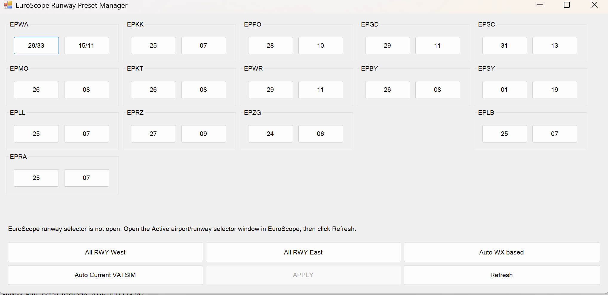

# EuroscopeRunwaySwitcher

EuroscopeRunwaySwitcher is a lightweight Windows utility designed for vATC on the VATSIM network. It lets controllers prepare individual airport presets or predefined West and East configurations, inspect the proposal, and apply it to EuroScope only after clicking **APPLY**. The application reads the current EuroScope runway state and highlights active presets with a green background.



## Features

- Selects configured departure and arrival runways for individual airports; only **APPLY** writes them to EuroScope.
- Selects all configured airports in **West** or **East** runway presets; only **APPLY** writes them to EuroScope.
- Supports separate departure and arrival runways, such as `29/33` for EPWA.
- Reads and verifies the actual runway state in EuroScope after **APPLY**.
- Highlights the current EuroScope preset in green and a selected, different preset in yellow.
- Uses an external JSON file for airport grouping, order and runway configuration.
- Uses the EuroScope MSAA accessibility tree first, with a native ListView fallback that resolves the exact DEP or ARR cell.
- Keeps the command buttons visible under Windows/Parallels DPI scaling; the airport list scrolls instead of clipping controls.
- **Auto WX based** mirrors the runway-selection rules from [arse](https://github.com/laxentis/arse): it reads VATSIM METAR, applies wind thresholds and runway preferences, then overlays only safe changes that differ from the current EuroScope state.
- **Auto Current VATSIM** reads the public [VATSIM ATIS feed](https://vatsim.dev/api/data-api/list-atis-stations/), recognizes common DEP/ARR runway wording, skips missing or unsafe ATIS data per airport, and overlays only safe changes that differ from the current EuroScope state.

## Configuration File

> [!IMPORTANT]
> The application requires a **runways.json** file in the same directory as **EuroScopeRunwayPresets.exe**. If the file is missing or invalid, the application will display an error and stop.

The configuration file defines:

- The airport columns and display order.
- The ICAO code of each airport.
- Departure and arrival runways for the West preset.
- Departure and arrival runways for the East preset.
- Optional automatic-weather metadata: runway true headings, preferences, an alternate METAR station and wind thresholds.

Example:

```json
{
  "autoWx": {
    "noFactorWind": 5,
    "prefWind": 15,
    "assumedWindDir": 270
  },
  "columns": [
    {
      "airports": [
        {
          "code": "EPWA",
          "west": { "dep": "29", "arr": "33" },
          "east": { "dep": "15", "arr": "11" },
          "auto": {
            "runways": [
              { "id": "11", "trueHeading": 115 },
              { "id": "29", "trueHeading": 295 },
              { "id": "15", "trueHeading": 152 },
              { "id": "33", "trueHeading": 332 }
            ],
            "preferredDep": ["29", "15", "33", "11"],
            "preferredArr": ["33", "11", "29", "15"]
          }
        },
        {
          "code": "EPWR",
          "west": { "dep": "29", "arr": "29" },
          "east": { "dep": "11", "arr": "11" },
          "auto": {
            "runways": [
              { "id": "11", "trueHeading": 116 },
              { "id": "29", "trueHeading": 296 }
            ]
          }
        }
      ]
    }
  ]
}
```

When departure and arrival use the same runway, the button displays one runway number. When they differ, the button displays both values in `DEP/ARR` format.

`autoWx.noFactorWind`, `autoWx.prefWind` and `autoWx.assumedWindDir` default to `5`, `15` and `270` respectively. An airport can override them in `auto`; `metarFrom` can point to another ICAO station. `preferredDep` and `preferredArr` are ordered runway lists. As in arse, a preferred-arrival airport uses the 15 kt threshold; otherwise the 5 kt threshold is used. Below the applicable threshold, and whenever the METAR reports `VRB`, the planner intentionally uses the configured default direction (270° by default) to choose a stable preferred configuration.

## Automatic VATSIM ATIS

The app downloads one current snapshot of VATSIM's `/afv-atis-data.json` endpoint. It accepts only exact airport callsigns from the configuration: `ICAO_ATIS`, `ICAO_D_ATIS` and `ICAO_A_ATIS`. It understands common forms such as `ARR RWY 26 DEP RWY 26`, `DEPARTURE RUNWAY 23R`, `RWY 29 FOR ARRIVALS`, `RWY IN USE 26`, and a bare `RWY 25` in a dedicated D/A ATIS.

It selects only detected states that map exactly to a visible preset tile. A generic phrase such as `RWY IN USE 29` is accepted only when it maps exactly to one configured preset. Conflicting ATIS entries, unrecognized wording, a missing station, or a runway not present in `runways.json` are skipped deliberately while the remaining airports are still processed. A skipped airport never clears an existing selected tile, and an automatic result equal to the green current state is ignored. Before changing any selection, an automatic option refreshes the current EuroScope state; if that read fails, it preserves both the existing selections and green tiles unchanged. Neither automatic option sends a click to EuroScope; use **APPLY** after reviewing the selected tiles.

## How to Use

1. Download the latest release and extract all files into one directory.
2. Keep **EuroScopeRunwayPresets.exe** and **runways.json** together.
3. Start EuroScope and open the **Active airport/runway selector** window.
4. Run **EuroScopeRunwayPresets.exe** and approve the Windows administrator prompt.
5. Click airport preset tiles, **All RWY West**, **All RWY East**, **Auto WX based**, or **Auto Current VATSIM** to prepare a proposal. These controls do not change EuroScope.
6. Review the tiles: green is the current EuroScope configuration; yellow is a selected configuration that differs from it. Click a selected individual tile again to remove it from the proposal.
7. Click **APPLY** and approve the one confirmation dialog to change only the selected airports.
8. Wait until the application verifies the selected configuration, then use **Refresh** whenever you need to read the current runway state again.

> [!WARNING]
> Do not close EuroScope or its Active airport/runway selector while a preset is being applied.

> [!IMPORTANT]
> The application requests administrator privileges so it can interact with EuroScope even when EuroScope itself is elevated. Windows may display a SmartScreen warning for an unsigned or unrecognized build; review the source and release provenance before deciding whether to run it.

## High-DPI displays and Parallels

The application is per-monitor DPI-aware. Its airport area can scroll and the command buttons use a responsive two-row layout, so they remain reachable instead of falling outside the client area. It first uses EuroScope's MSAA default action, which is independent of cursor and screen scaling. If that interface is unavailable or has no effect, it queries EuroScope's native `SysListView32` control: it finds the one row whose Airport and RWY columns match the requested airport/runway, makes that item visible, reads the actual DEP or ARR subitem rectangle, and native-hit-tests it before sending one real click. It never uses a recycled UI Automation rectangle for a physical click. The guest cursor is restored immediately afterwards unless the controller moves it.

If an older build still clicks the wrong cell, use Parallels **Scaled** display mode and Windows display scale **100%** as a temporary workaround, then rebuild the current source on Windows.

## Building from Source

1. Download or clone the repository on Windows.
2. Run **BUILD.cmd**.
3. The compiled executable and a copy of **runways.json** will be created in the **build** directory.

The build script targets x86 to match EuroScope and uses the C# compiler included with Microsoft .NET Framework 4 together with Windows UI Automation and MSAA accessibility APIs.
